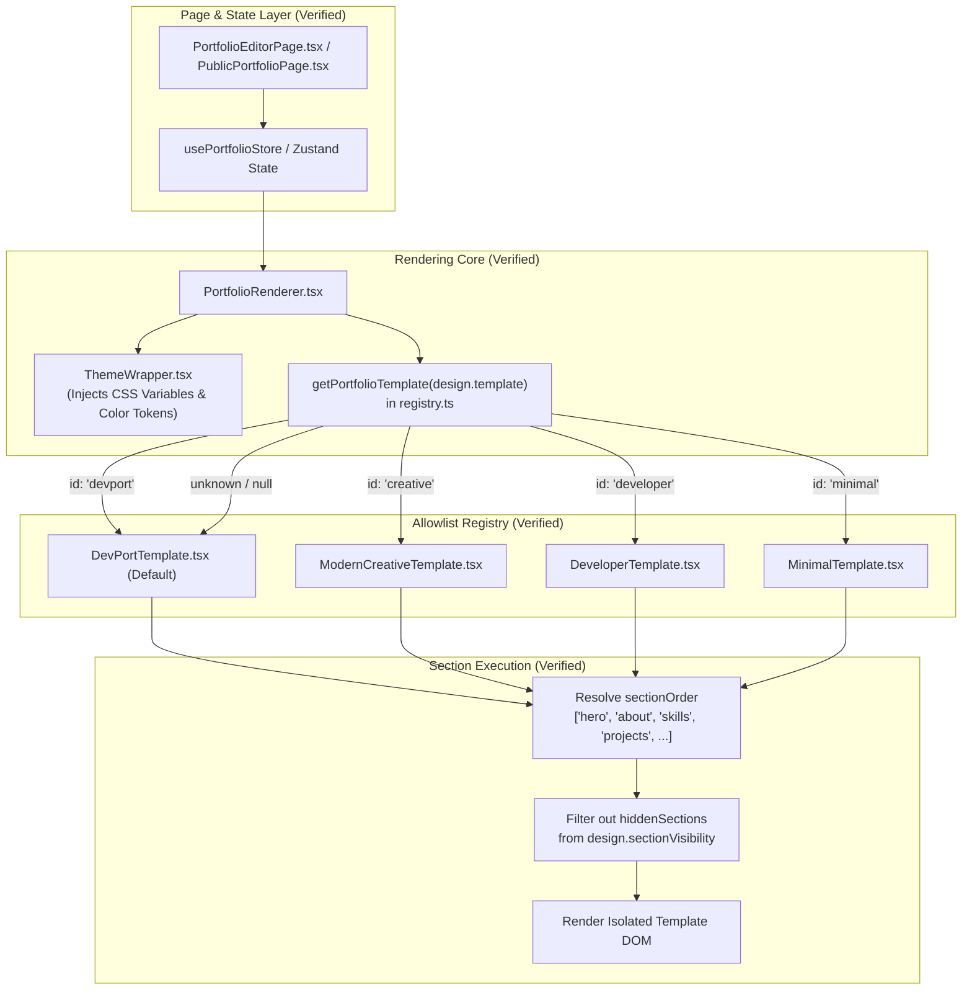
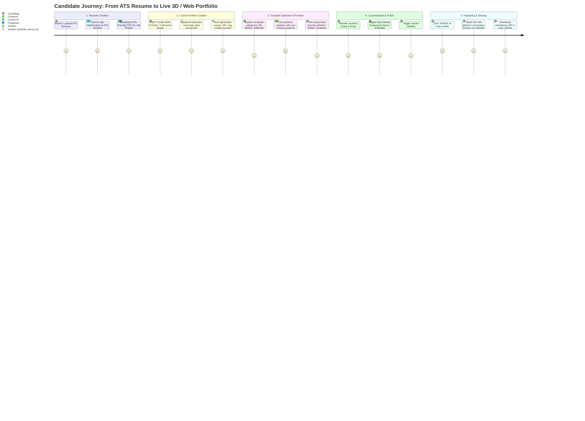
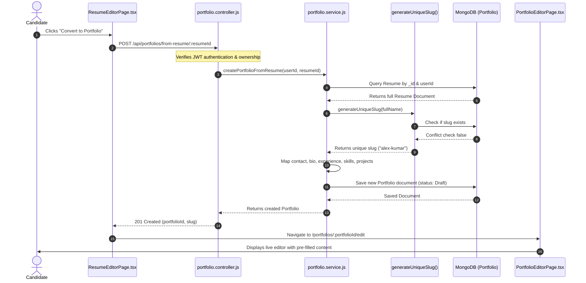
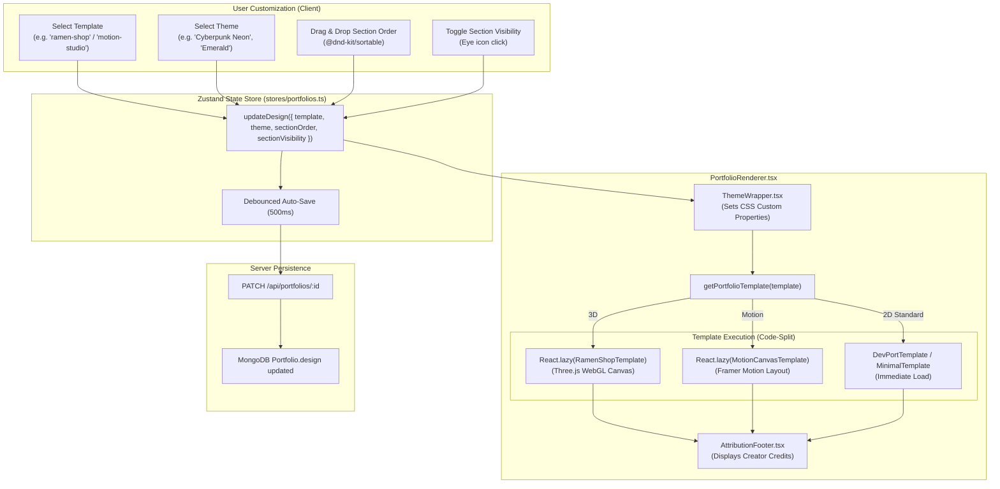
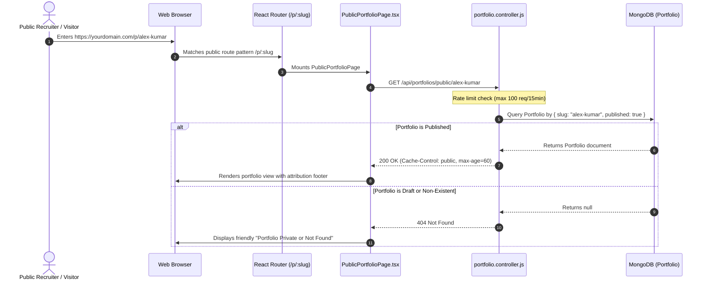
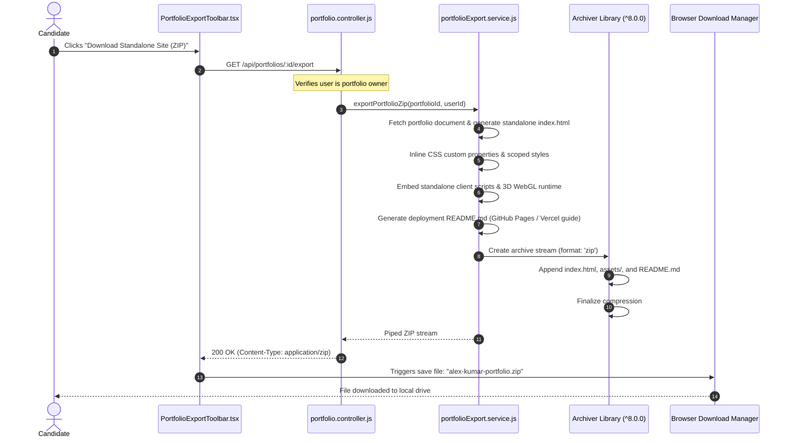
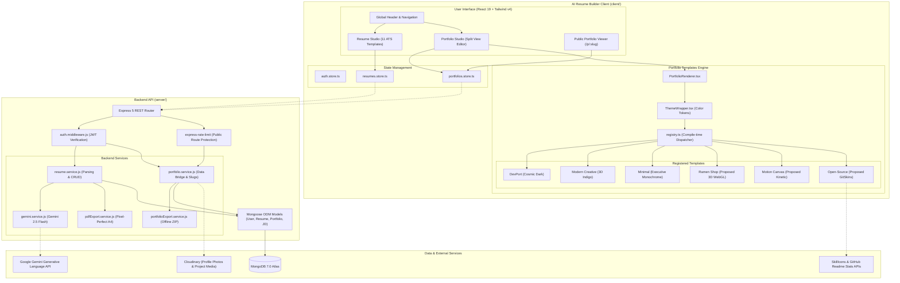

# Application Flows & Interaction Architecture
## Portfolio Builder Integration for AI Resume Builder

**Document Version:** 1.0.0  
**Status:** Approved System Diagrams  
**Last Updated:** October 24, 2026  

---

## 1. Existing Portfolio Rendering Flow

This diagram illustrates the **verified active rendering pipeline** in `client/src/components/portfolios/`:

---

## 2. Proposed End-to-End User Journey

This flow shows how a candidate moves seamlessly from an **ATS Resume** to a **Published Web Portfolio**:

---

## 3. Resume-to-Portfolio Generation Flow

Detailed execution sequence of the **1-Click Conversion Bridge**:

---

## 4. Template Selection & Customization Flow

Illustrates how template switches, color themes, and dynamic layout mutations occur without data loss:

---

## 5. Portfolio Publishing & Public Access Flow

Illustrates public URL resolution, caching, access control, and 404 security handling:

---

## 6. Standalone Portfolio ZIP Export Flow

Shows how the backend packages complete offline web applications:

---

## 7. High-Level System Architecture Diagram

---

*Application flows and architectural diagrams complete. Fully aligned with verified codebase structure.*
