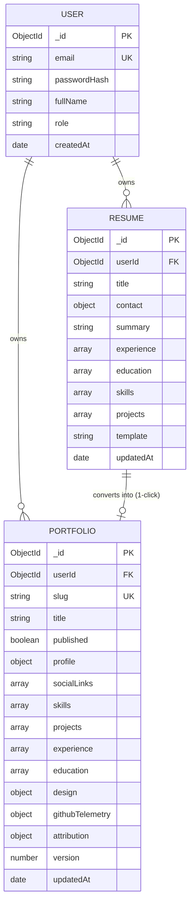

# Database Architecture & Schema Specification
## Portfolio Builder Integration for AI Resume Builder

**Document Version:** 1.0.0  
**Status:** Verified & Proposed Architecture  
**Database Engine:** MongoDB 7.0+ (Mongoose ODM v9.9.1)  
**Last Updated:** October 24, 2026  

---

## 1. Existing vs. Proposed Schema Overview

### 1.1 Architectural Decision: Zero Destructive Schema Changes
The existing Mongoose `Portfolio` collection schema located at [`server/src/models/Portfolio.js`](file:///C:/Users/sunil/OneDrive/Desktop/project-resume/AI-Resume-builder/server/src/models/Portfolio.js) was designed with forward-compatibility for modular portfolio templates. 

Therefore:
* **No breaking schema migrations or collection drops are required.**
* The core document fields (`profile`, `socialLinks`, `skills`, `projects`, `experience`, `education`, `design`, `published`, `slug`) map 1:1 to GitSkins-inspired templates.
* Only minor, backward-compatible extensions are proposed to store GitHub telemetry flags, 3D asset configurations, and author attribution metadata.

---

## 2. Verified Current Schema (`server/src/models/Portfolio.js`)

```javascript
// Current Mongoose Document Definition
const portfolioSchema = new mongoose.Schema(
  {
    userId: {
      type: mongoose.Schema.Types.ObjectId,
      ref: "User",
      required: true,
      index: true,
    },
    title: {
      type: String,
      default: "My Portfolio",
      trim: true,
      maxlength: 200,
    },
    slug: {
      type: String,
      required: true,
      unique: true,
      lowercase: true,
      trim: true,
      index: true,
    },
    published: {
      type: Boolean,
      default: false,
      index: true,
    },
    profile: {
      fullName: { type: String, default: "", trim: true, maxlength: 200 },
      headline: { type: String, default: "", trim: true, maxlength: 300 },
      bio: { type: String, default: "", trim: true, maxlength: 5000 },
      email: { type: String, default: "", trim: true, maxlength: 254 },
      phone: { type: String, default: "", trim: true, maxlength: 50 },
      location: { type: String, default: "", trim: true, maxlength: 200 },
      avatarUrl: { type: String, default: "", trim: true, maxlength: 2000000 },
    },
    socialLinks: [
      {
        platform: { type: String, default: "", trim: true, maxlength: 50 },
        label: { type: String, default: "", trim: true, maxlength: 100 },
        url: { type: String, default: "", trim: true, maxlength: 1000 },
      },
    ],
    skills: [
      {
        name: { type: String, required: true, trim: true, maxlength: 100 },
        category: { type: String, default: "General", trim: true, maxlength: 100 },
        level: {
          type: String,
          enum: ["beginner", "intermediate", "advanced", "expert"],
          default: "intermediate",
        },
      },
    ],
    projects: [
      {
        title: { type: String, default: "", trim: true, maxlength: 200 },
        subtitle: { type: String, default: "", trim: true, maxlength: 300 },
        description: { type: String, default: "", trim: true, maxlength: 5000 },
        tags: [{ type: String, trim: true, maxlength: 50 }],
        repoUrl: { type: String, default: "", trim: true, maxlength: 1000 },
        liveUrl: { type: String, default: "", trim: true, maxlength: 1000 },
        imageUrl: { type: String, default: "", trim: true, maxlength: 2000000 },
        featured: { type: Boolean, default: false },
        order: { type: Number, default: 0 },
      },
    ],
    experience: [
      {
        title: { type: String, default: "", trim: true, maxlength: 200 },
        company: { type: String, default: "", trim: true, maxlength: 200 },
        location: { type: String, default: "", trim: true, maxlength: 200 },
        startDate: { type: String, default: "", maxlength: 50 },
        endDate: { type: String, default: "", maxlength: 50 },
        description: { type: String, default: "", maxlength: 5000 },
        technologies: { type: String, default: "", maxlength: 500 },
      },
    ],
    education: [
      {
        institution: { type: String, default: "", trim: true, maxlength: 200 },
        degree: { type: String, default: "", trim: true, maxlength: 200 },
        fieldOfStudy: { type: String, default: "", trim: true, maxlength: 200 },
        graduationDate: { type: String, default: "", maxlength: 50 },
      },
    ],
    design: {
      template: {
        type: String,
        enum: ["devport", "creative", "developer", "minimal"],
        default: "devport",
      },
      theme: { type: String, default: "default" },
      font: { type: String, default: "Geist" },
      sectionOrder: {
        type: [String],
        default: ["hero", "about", "skills", "projects", "experience", "education", "contact"],
      },
      sectionVisibility: { type: Map, of: Boolean, default: {} },
      customCss: { type: String, default: "", maxlength: 10000 },
    },
    version: { type: Number, default: 1 },
  },
  {
    timestamps: true,
  }
);
```

---

## 3. Proposed Schema Enhancements (Non-Breaking)

To support GitSkins-inspired templates (3D WebGL scenes, kinetic typography, and open-source telemetry), the following targeted enhancements are proposed:

### 3.1 Template Enum Extension
Expand `design.template` enum to include the newly integrated templates:
```javascript
// PROPOSED: Updated enum in server/src/models/Portfolio.js
design: {
  template: {
    type: String,
    enum: [
      "devport",
      "creative",
      "developer",
      "minimal",
      "ramen-shop",      // [PROPOSED] 3D WebGL Arcade Diner
      "motion-studio",   // [PROPOSED] Kinetic Editorial
      "oss-maintainer",  // [PROPOSED] GitHub Telemetry & Maintainer Profile
    ],
    default: "devport",
  },
  // ...
}
```

### 3.2 Optional GitHub Telemetry & Upstream Metadata Sub-schema
Add an optional `githubTelemetry` subdocument to store cached repository data, stars, and attribution notices without requiring real-time GitHub API calls on every public visit:

```javascript
// PROPOSED: Optional subdocument added to Portfolio Schema
githubTelemetry: {
  githubUsername: { type: String, default: "", trim: true, maxlength: 100 },
  starsCount: { type: Number, default: 0 },
  followersCount: { type: Number, default: 0 },
  publicReposCount: { type: Number, default: 0 },
  primaryLanguage: { type: String, default: "", maxlength: 50 },
  lastSyncedAt: { type: Date, default: null },
},
attribution: {
  author: { type: String, default: "" },
  repo: { type: String, default: "" },
  license: { type: String, default: "MIT" },
  displayFooter: { type: Boolean, default: true },
}
```

---

## 4. Entity-Relationship Diagram (ERD)



---

## 5. Indexes, Constraints & Performance Plan

| Collection | Field(s) | Index Type | Unique | Purpose |
| :--- | :--- | :---: | :---: | :--- |
| `portfolios` | `slug` | Single Field | **Yes** | Fast O(1) resolution for public routes (`/p/:slug`). |
| `portfolios` | `userId` | Single Field | No | Index for fast dashboard retrieval (`/api/portfolios`). |
| `portfolios` | `published`, `slug` | Compound | No | Composite index for public visitor queries (`published: true`). |
| `portfolios` | `createdAt` | Single Field | No | Fast sorting in user portfolio management list. |

---

## 6. Validation Rules & Data Sanitization

* **Slug Format Validation:**
  - Standard regex: `/^[a-z0-9]+(?:-[a-z0-9]+)*$/`
  - Min length: 3 characters, Max length: 40 characters.
* **XSS Prevention:**
  - All text inputs (`bio`, `description`, `headline`, `title`) are sanitized using string trimming and HTML entity escaping before persisting.
* **URL Validation:**
  - `repoUrl`, `liveUrl`, and `socialLinks[].url` must match `/^https?:\/\/[^\s$.?#].[^\s]*$/i`.

---

*Database architecture specification complete. No breaking changes required.*
