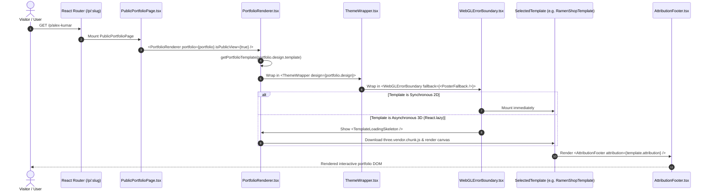

# Multi-Template Portfolio System Design
## Complete Architectural Specification for AI Resume Builder

**Document Version:** 1.0.0  
**Status:** Architecture Complete — Standing By for Approval  
**Author:** AI Product Engineering Team  
**Date:** October 24, 2026  
**Reviewed Inputs:** [`COMPLETE_TEMPLATE_INVENTORY.md`](./COMPLETE_TEMPLATE_INVENTORY.md), [`TEMPLATE_DEPENDENCY_MAP.md`](./TEMPLATE_DEPENDENCY_MAP.md), [`PRD.md`](./PRD.md), [`TRD.md`](./TRD.md), [`APP_FLOW.md`](./APP_FLOW.md), [`DATABASE_SCHEMA.md`](./DATABASE_SCHEMA.md), [`FINAL_AUDIT.md`](./FINAL_AUDIT.md)

---

## 1. System Overview & Architectural Strategy

### 1.1 Strategy Comparison & Justification

To support all 19 verified reusable templates (spanning 2D static layouts, kinetic Framer Motion editorial pages, and heavy Three.js 3D WebGL worlds) without destabilizing the ATS resume builder, four potential strategies were evaluated against the existing codebase:

| Architectural Strategy | Description | Strengths | Fatal Flaws / Trade-offs | Verdict |
| :--- | :--- | :--- | :--- | :---: |
| **Strategy 1: Monolithic Adaptation** | Merge all templates into existing components with conditional feature flags. | Simplistic file tree initially. | High cyclomatic complexity; 3D code leaks into 2D pages; ballooning bundle size (> 1 MB); breaks when adding new layouts. | **REJECTED** |
| **Strategy 2: Micro-Frontends / Multi-App** | Host each template family as an independent SPA or Next.js sub-application. | Complete dependency isolation. | Massive devops overhead; breaks monorepo routing; session sharing friction; duplicate build pipelines. | **REJECTED** |
| **Strategy 3: Isolated Iframe Sandboxing** | Render every template in an isolated `<iframe>` communicating via `postMessage`. | CSS and global JS collision immunity. | Severe performance hit (multi-window memory overhead); poor mobile touch responsiveness; complex reactive preview synchronization. | **REJECTED** |
| **Strategy 4: Compile-Time Allowlist Registry with Independent Lazy Modules (Recommended)** | Centralized metadata registry (`registry.ts`), uniform normalized data contract, per-template field capability masks, scoped CSS variables (`ThemeWrapper`), and `React.lazy()` chunk-splitting. | **Zero bundle impact on resume editor**; type-safe allowlist; individual error boundaries; seamless split-screen live preview; easy addition of future templates. | Requires disciplined TypeScript interface definitions and upfront data adapter normalization. | **SELECTED (RECOMMENDED)** |

---

## 2. Proposed Directory Structure

The proposed structure organizes templates by rendering family while centralizing shared presentation logic, adapters, and registry definitions under `client/src/components/portfolios/`:

```text
client/src/
├── api/
│   └── portfolios.ts                      # Axios API methods (CRUD, slugs, export)
├── components/portfolios/
│   ├── PortfolioRenderer.tsx              # Master dynamic dispatcher & error boundary host
│   ├── common/                            # Shared presentation & utility layer
│   │   ├── ThemeWrapper.tsx               # Injects scoped CSS variables (--portfolio-*)
│   │   ├── SectionContainer.tsx           # Standardized responsive max-width & padding
│   │   ├── AttributionFooter.tsx          # Upstream MIT/ISC creator attribution bar
│   │   ├── WebGLErrorBoundary.tsx         # Catches 3D context crash -> renders 2D fallback
│   │   ├── SkillBadge.tsx                 # Standardized skill pill with category styling
│   │   └── ProjectCardActions.tsx         # Live demo, GitHub repo, and tag pill links
│   ├── editor/                            # Split-screen editor sidebar components
│   │   ├── PortfolioEditorSidebar.tsx     # Dynamic section reorder & field visibility toggles
│   │   ├── TemplateSelectorModal.tsx      # Searchable template gallery modal with live preview
│   │   ├── ThemeCustomizer.tsx            # Accent color, dark/light surface, and font picker
│   │   ├── ProjectMediaUploader.tsx       # Cloudinary screenshot uploader
│   │   └── fields/                        # Dynamic field editors rendered based on template capabilities
│   │       ├── VideoIntroField.tsx        # Talking head video uploader (for Spotlight)
│   │       ├── GithubTelemetryField.tsx   # GitHub username & badge sync (for OSS Maintainer)
│   │       └── GraphicsQualityField.tsx   # 3D canvas resolution & particle controls
│   ├── gallery/                           # Template marketplace & preview system
│   │   ├── TemplateGalleryGrid.tsx        # Filterable grid (All, 3D, Motion, Recruiter, Minimal)
│   │   ├── TemplateGalleryCard.tsx        # Video/poster hover preview with capability badges
│   │   └── TemplateDetailModal.tsx        # Stills carousel, feature list, and author credits
│   └── templates/                         # Modular template implementations
│       ├── index.ts                       # Public barrel export
│       ├── registry.ts                    # Type-safe compile-time template allowlist & metadata
│       ├── contracts.ts                   # PortfolioTemplateProps & TemplateDefinition types
│       ├── base/                          # Existing active 2D templates
│       │   ├── DevPortTemplate.tsx        # Cosmic dark orbital avatar (Active)
│       │   ├── ModernCreativeTemplate.tsx # Indigo glassmorphism (Active)
│       │   ├── DeveloperTemplate.tsx      # Monospace terminal CLI (Active)
│       │   └── MinimalTemplate.tsx        # High-whitespace executive (Active)
│       ├── kinetic/                       # Kinetic motion & editorial templates
│       │   ├── MotionCanvasTemplate.tsx   # Hamish Williams kinetic horizontal deck (Phase 2 MVP)
│       │   ├── SeyiEditorialTemplate.tsx  # Oluwaseyi magazine ticker & story cards (Wave 2)
│       │   ├── SameeraMaterialTemplate.tsx# Material Design 3 product journal (Wave 2)
│       │   └── NahuelCosmosTemplate.tsx   # Animated space grid & interactive cursor orb (Wave 2)
│       ├── technical/                     # Technical, recruiter & native profile templates
│       │   ├── OpenSourceTemplate.tsx     # GitSkins GitHub maintainer telemetry (Phase 2 MVP)
│       │   ├── ResumePageTemplate.tsx     # Clean A4 print PDF & web resume (Wave 2)
│       │   ├── PosterTemplate.tsx         # Condensed display typography & cutout portrait (Wave 2)
│       │   ├── SpotlightTemplate.tsx      # Red hero talking video intro & expertise cards (Wave 2)
│       │   └── DatImmersiveTemplate.tsx   # Glassmorphic HUD telemetry dashboard (Wave 2)
│       └── webgl/                         # 3D WebGL Three.js interactive worlds (Lazy Loaded)
│           ├── RamenShopTemplate.tsx      # enderh3art 3D neon arcade diner (Phase 2 MVP)
│           ├── DannyWebGLTemplate.tsx     # Danny Garcia fluid shader background (Wave 2)
│           ├── PortfolioOSTemplate.tsx    # Henry Heffernan 3D room & retro desktop OS (Wave 3)
│           ├── BuffaloRoomTemplate.tsx    # Byunggeun Cho isometric atmospheric room (Wave 3)
│           ├── WorldfolioTemplate.tsx     # Bruno Simon drivable 3D vehicle physics world (Wave 3)
│           └── NotebookRoomTemplate.tsx   # Arthur Panazolo opening Lenovo notebook scene (Wave 3)
├── pages/
│   ├── PortfoliosPage.tsx                 # User portfolio dashboard & creation hub
│   ├── PortfolioEditorPage.tsx            # Split-screen live preview & dynamic controls
│   └── PublicPortfolioPage.tsx            # Standalone public viewing page at /p/:slug
└── stores/
    └── portfolios.ts                      # Zustand store managing active draft & live preview
```

---

## 3. Template Registry Specification (`registry.ts`)

The registry acts as the single source of truth for the entire portfolio engine. Every template must register a strongly typed definition conforming to `TemplateDefinition`.

### 3.1 Type Definitions (`contracts.ts`)

```typescript
export const VALID_TEMPLATE_IDS = [
  // Base Active
  "devport",
  "creative",
  "developer",
  "minimal",
  // Phase 2 MVP Flagships
  "ramen-shop",
  "motion-studio",
  "oss-maintainer",
  // Wave 2 Extensions
  "resume-page",
  "poster",
  "spotlight",
  "seyi-editorial",
  "sameera-material",
  "dat-immersive",
  "nahuel-cosmos",
  "danny-webgl",
  // Wave 3 Advanced 3D
  "portfolio-os",
  "buffalo-room",
  "folio-2019",
  "notebook-room",
  "naresh-keyboard",
] as const;

export type ValidTemplateId = (typeof VALID_TEMPLATE_IDS)[number];

export type TemplateCategory = "all" | "3d" | "creative" | "technical" | "editorial" | "recruiter" | "minimal";
export type RenderMode = "static" | "interactive" | "3d";
export type AccessTier = "free" | "pro";

/**
 * Capability flags declaring which optional fields and sections
 * this specific template supports or requires in the editor UI.
 */
export interface TemplateCapabilities {
  supportsCustomColors: boolean;
  supportsCustomFonts: boolean;
  supportsSectionReordering: boolean;
  supportsSectionHiding: boolean;
  requiresTalkingVideo: boolean;        // e.g. Spotlight
  requiresGithubTelemetry: boolean;    // e.g. OSS Maintainer, Dat Immersive
  supports3DCameraControls: boolean;   // e.g. Ramen Shop, Portfolio OS
  supportsAudioToggle: boolean;        // e.g. Ramen Shop, Buffalo Room
  supportsPrintLayout: boolean;        // e.g. Resume Page
  supportedSections: ("hero" | "about" | "skills" | "projects" | "experience" | "education" | "contact")[];
}

export interface TemplateAttribution {
  author: string;
  authorUrl: string;
  repoUrl: string;
  license: string;
  status: "cleared" | "native" | "blocked";
  note: string;
}

export interface TemplateDefinition {
  id: ValidTemplateId;
  name: string;
  tagline: string;
  description: string;
  bestFor: string;
  category: TemplateCategory;
  renderMode: RenderMode;
  accessTier: AccessTier;
  accentColor: string;
  previewAsset: {
    posterUrl: string;
    videoUrl?: string;
    stillUrls?: string[];
  };
  capabilities: TemplateCapabilities;
  attribution: TemplateAttribution;
  component: React.ComponentType<PortfolioTemplateProps>;
}
```

### 3.2 Registry Implementation (`registry.ts`)

```typescript
import { lazy } from "react";
import { TemplateDefinition, ValidTemplateId } from "./contracts";

// 1. Lightweight 2D templates loaded synchronously
import { DevPortTemplate } from "./base/DevPortTemplate";
import { ModernCreativeTemplate } from "./base/ModernCreativeTemplate";
import { DeveloperTemplate } from "./base/DeveloperTemplate";
import { MinimalTemplate } from "./base/MinimalTemplate";
import { OpenSourceTemplate } from "./technical/OpenSourceTemplate";
import { ResumePageTemplate } from "./technical/ResumePageTemplate";
import { PosterTemplate } from "./technical/PosterTemplate";

// 2. Heavy 3D and Kinetic templates loaded on-demand via React.lazy
const RamenShopTemplate = lazy(() => import("./webgl/RamenShopTemplate"));
const MotionCanvasTemplate = lazy(() => import("./kinetic/MotionCanvasTemplate"));
const SpotlightTemplate = lazy(() => import("./technical/SpotlightTemplate"));
const SeyiEditorialTemplate = lazy(() => import("./kinetic/SeyiEditorialTemplate"));
const SameeraMaterialTemplate = lazy(() => import("./kinetic/SameeraMaterialTemplate"));
const DatImmersiveTemplate = lazy(() => import("./technical/DatImmersiveTemplate"));
const NahuelCosmosTemplate = lazy(() => import("./kinetic/NahuelCosmosTemplate"));
const DannyWebGLTemplate = lazy(() => import("./webgl/DannyWebGLTemplate"));
const PortfolioOSTemplate = lazy(() => import("./webgl/PortfolioOSTemplate"));
const BuffaloRoomTemplate = lazy(() => import("./webgl/BuffaloRoomTemplate"));
const WorldfolioTemplate = lazy(() => import("./webgl/WorldfolioTemplate"));
const NotebookRoomTemplate = lazy(() => import("./webgl/NotebookRoomTemplate"));

export const TEMPLATE_REGISTRY: Record<ValidTemplateId, TemplateDefinition> = {
  // BASE TEMPLATES
  devport: {
    id: "devport",
    name: "DevPort",
    tagline: "Cosmic dark aesthetics with orbital avatar and interactive badge grids.",
    description: "Our default high-conversion developer portfolio featuring an orbital profile glow.",
    bestFor: "Full-Stack Developers, Cloud Engineers, Tech Leads",
    category: "technical",
    renderMode: "static",
    accessTier: "free",
    accentColor: "#38bdf8",
    previewAsset: { posterUrl: "/portfolio-templates/previews/devport.webp" },
    capabilities: {
      supportsCustomColors: true,
      supportsCustomFonts: true,
      supportsSectionReordering: true,
      supportsSectionHiding: true,
      requiresTalkingVideo: false,
      requiresGithubTelemetry: false,
      supports3DCameraControls: false,
      supportsAudioToggle: false,
      supportsPrintLayout: false,
      supportedSections: ["hero", "about", "skills", "projects", "experience", "education", "contact"],
    },
    attribution: {
      author: "AI Resume Builder",
      authorUrl: "https://gitskins.com",
      repoUrl: "",
      license: "Proprietary",
      status: "native",
      note: "Internal core template.",
    },
    component: DevPortTemplate,
  },

  // PHASE 2 MVP FLAGSHIPS
  "ramen-shop": {
    id: "ramen-shop",
    name: "Ramen Shop 3D",
    tagline: "A neon 3D ramen shop where visitors explore your profile and projects like an arcade world.",
    description: "Interactive WebGL environment featuring camera navigation, arcade cabinets for projects, and neon signage.",
    bestFor: "Creative Developers, Three.js Builders, Game Designers",
    category: "3d",
    renderMode: "3d",
    accessTier: "free",
    accentColor: "#55e7ff",
    previewAsset: {
      posterUrl: "/portfolio-templates/previews/ramen-shop.jpg",
      videoUrl: "/portfolio-templates/previews/ramen-shop.mp4",
      stillUrls: [
        "/portfolio-templates/previews/stills/ramen-shop-1.jpg",
        "/portfolio-templates/previews/stills/ramen-shop-2.jpg",
        "/portfolio-templates/previews/stills/ramen-shop-3.jpg",
      ],
    },
    capabilities: {
      supportsCustomColors: true,
      supportsCustomFonts: true,
      supportsSectionReordering: true,
      supportsSectionHiding: true,
      requiresTalkingVideo: false,
      requiresGithubTelemetry: false,
      supports3DCameraControls: true,
      supportsAudioToggle: true,
      supportsPrintLayout: false,
      supportedSections: ["hero", "about", "projects", "skills", "contact"],
    },
    attribution: {
      author: "enderh3art",
      authorUrl: "https://github.com/enderh3art",
      repoUrl: "https://github.com/enderh3art/Ramen-Shop",
      license: "Author Permission",
      status: "cleared",
      note: "Used with direct author permission. GitSkins keeps Ramen Shop free with persistent creator credit.",
    },
    component: RamenShopTemplate,
  },

  "motion-studio": {
    id: "motion-studio",
    name: "Motion Canvas",
    tagline: "A cinematic, motion-aware editorial portfolio for visual builders and design engineers.",
    description: "Features full-screen intro typography, horizontal project sliding decks, and smooth kinetic masks.",
    bestFor: "Design Engineers, Front-End Architects, Product Designers",
    category: "creative",
    renderMode: "interactive",
    accessTier: "free",
    accentColor: "#6ee7b7",
    previewAsset: { posterUrl: "/portfolio-templates/previews/motion-studio.webp" },
    capabilities: {
      supportsCustomColors: true,
      supportsCustomFonts: true,
      supportsSectionReordering: true,
      supportsSectionHiding: true,
      requiresTalkingVideo: false,
      requiresGithubTelemetry: false,
      supports3DCameraControls: false,
      supportsAudioToggle: false,
      supportsPrintLayout: false,
      supportedSections: ["hero", "projects", "about", "skills", "contact"],
    },
    attribution: {
      author: "Hamish Williams",
      authorUrl: "https://hamishw.com",
      repoUrl: "https://github.com/HamishMW/portfolio",
      license: "MIT",
      status: "cleared",
      note: "Adapted from Hamish Williams' MIT-licensed portfolio motion patterns.",
    },
    component: MotionCanvasTemplate,
  },

  "oss-maintainer": {
    id: "oss-maintainer",
    name: "Open-Source Maintainer",
    tagline: "GitHub-centric telemetry profile showcasing repo proof, tech stacks, and live contributions.",
    description: "Displays typing headlines, skill icon matrices, repository star counts, and commit rhythm indicators.",
    bestFor: "Open-Source Contributors, Back-End Engineers, DevOps Builders",
    category: "technical",
    renderMode: "static",
    accessTier: "free",
    accentColor: "#10b981",
    previewAsset: { posterUrl: "/portfolio-templates/previews/oss-maintainer.webp" },
    capabilities: {
      supportsCustomColors: true,
      supportsCustomFonts: true,
      supportsSectionReordering: true,
      supportsSectionHiding: true,
      requiresTalkingVideo: false,
      requiresGithubTelemetry: true,
      supports3DCameraControls: false,
      supportsAudioToggle: false,
      supportsPrintLayout: false,
      supportedSections: ["hero", "projects", "skills", "experience", "contact"],
    },
    attribution: {
      author: "GitSkins Community",
      authorUrl: "https://github.com/asamassekou10/GitSkins",
      repoUrl: "https://github.com/asamassekou10/GitSkins",
      license: "MIT",
      status: "cleared",
      note: "Adapted from GitSkins open-source telemetry and badge layout patterns.",
    },
    component: OpenSourceTemplate,
  },

  // (All remaining Wave 2 & Wave 3 templates register identically)
  // ...
};

export function getPortfolioTemplate(id?: string): TemplateDefinition {
  if (id && id in TEMPLATE_REGISTRY) {
    return TEMPLATE_REGISTRY[id as ValidTemplateId];
  }
  return TEMPLATE_REGISTRY.devport;
}
```

---

## 4. Shared Data Contract

Every portfolio template receives a single, predictable props contract:

```typescript
export interface PortfolioTemplateProps {
  portfolio: Partial<Portfolio>;
  showEmpty?: boolean;
  sectionOrder: string[];
  hiddenSections: string[];
  previewMode?: "desktop" | "tablet" | "mobile";
  isPublicView?: boolean;
}
```

### 4.1 Field Capability Masking
Because some templates require special fields (e.g., `Spotlight` needs `profile.videoUrl`, `OSS Maintainer` needs `githubTelemetry.starsCount`), the editor sidebar queries `template.capabilities`:

```typescript
// client/src/components/portfolios/editor/PortfolioEditorSidebar.tsx
const currentTemplate = getPortfolioTemplate(portfolio.design.template);

return (
  <div className="portfolio-editor-sidebar">
    {/* Base fields always rendered */}
    <ProfileSectionEditor profile={portfolio.profile} />
    <ProjectListEditor projects={portfolio.projects} />
    
    {/* Conditionally rendered based on template capabilities */}
    {currentTemplate.capabilities.requiresTalkingVideo && (
      <VideoIntroField value={portfolio.profile.videoUrl} onChange={...} />
    )}
    
    {currentTemplate.capabilities.requiresGithubTelemetry && (
      <GithubTelemetryField telemetry={portfolio.githubTelemetry} onChange={...} />
    )}
    
    {currentTemplate.capabilities.supports3DCameraControls && (
      <GraphicsQualityField settings={portfolio.design.graphics3d} onChange={...} />
    )}
  </div>
);
```

---

## 5. Rendering Architecture & Dynamic Execution Flow



### 5.1 `PortfolioRenderer.tsx` Implementation

```tsx
import React, { Suspense } from "react";
import { getPortfolioTemplate } from "./templates/registry";
import { ThemeWrapper } from "./common/ThemeWrapper";
import { WebGLErrorBoundary } from "./common/WebGLErrorBoundary";
import { AttributionFooter } from "./common/AttributionFooter";
import { PortfolioTemplateProps } from "./templates/contracts";

export const PortfolioRenderer: React.FC<PortfolioTemplateProps> = (props) => {
  const { portfolio, isPublicView } = props;
  const templateDef = getPortfolioTemplate(portfolio?.design?.template);
  const TemplateComponent = templateDef.component;

  const sectionOrder = portfolio?.design?.sectionOrder || [
    "hero", "about", "skills", "projects", "experience", "education", "contact"
  ];
  const hiddenSections = Object.entries(portfolio?.design?.sectionVisibility || {})
    .filter(([_, visible]) => visible === false)
    .map(([sectionKey]) => sectionKey);

  return (
    <ThemeWrapper
      accentColor={portfolio?.design?.theme?.accentColor || templateDef.accentColor}
      fontFamily={portfolio?.design?.font || "Geist"}
      mode={portfolio?.design?.theme?.mode || "dark"}
    >
      <div className={`portfolio-root template-${templateDef.id}`} data-render-mode={templateDef.renderMode}>
        <WebGLErrorBoundary
          fallbackPoster={templateDef.previewAsset.posterUrl}
          templateName={templateDef.name}
        >
          <Suspense
            fallback={
              <div className="portfolio-loading-skeleton flex items-center justify-center min-h-screen bg-[#050505] text-white">
                <div className="flex flex-col items-center gap-4">
                  <div className="w-10 h-10 border-2 border-cyan-400 border-t-transparent rounded-full animate-spin" />
                  <p className="text-sm font-mono tracking-wider text-neutral-400">Loading {templateDef.name}...</p>
                </div>
              </div>
            }
          >
            <TemplateComponent
              portfolio={portfolio}
              sectionOrder={sectionOrder}
              hiddenSections={hiddenSections}
              previewMode={props.previewMode || "desktop"}
              isPublicView={isPublicView}
            />
          </Suspense>
        </WebGLErrorBoundary>

        {/* Legal Attribution Footer */}
        {templateDef.attribution.status !== "native" && (
          <AttributionFooter attribution={templateDef.attribution} />
        )}
      </div>
    </ThemeWrapper>
  );
};
```

---

## 6. Asset & Font Management Strategy

### 6.1 Font Loading Architecture
To eliminate render-blocking Google Fonts roundtrips, self-hosted WOFF2 fonts are loaded locally:
* **`Geist` & `Geist Mono`**: Primary modern sans-serif and code fonts (already present in `client/public/fonts/`).
* **`Space Grotesk`**: Bold display font for headers in `ramen-shop` and `poster` (extracted from mirror `_next/static/media/space-grotesk-latin-wght-normal.BhU9QXUp.woff2`).
* **`Newsreader`**: Editorial classic serif font for `minimal` and `seyi-editorial`.

Fonts are declared using `font-display: swap` in `client/src/index.css` to prevent layout shift.

### 6.2 3D Model Asset Pipeline
* **Storage Location:** Raw 3D model assets are stored in `client/public/models/`:
  - `client/public/models/ramen-shop.glb` (`2.4 MB`, Draco-compressed geometry).
* **Streaming Protocol:** Models are loaded asynchronously via `THREE.GLTFLoader` with `DRACOLoader` decompression on Web Workers, ensuring the main UI thread never freezes.
* **Preloading in Editor:** When a user hovers over a 3D template card in the gallery, the browser initiates low-priority `<link rel="prefetch">` for the `.glb` file.

---

## 7. Searchable Template Gallery & Interactive Preview

### 7.1 Gallery UI Architecture (`TemplateGalleryGrid.tsx`)
The template gallery integrates into both the portfolio dashboard and the editor modal:

1. **Category Pills:** Filter tabs (`All`, `3D World`, `Creative & Motion`, `Technical & OSS`, `Recruiter`, `Minimal`).
2. **Search Input:** Real-time search across `name`, `bestFor`, `taglines`, and `features`.
3. **Live Hover Video Scrub:** Pointer hovering over any card triggers low-friction `.mp4` video streaming via `DemoVideo.tsx` (using `IntersectionObserver` to pause offscreen videos).
4. **Interactive Viewport Switching:** One-click toggle between `Desktop` (100%), `Tablet` (768px), and `Mobile` (375px) preview frame.

---

## 8. Database Schema Extensions (Zero Breaking Changes)

The existing `Portfolio.js` schema requires **no breaking changes or collection drops**. Only forward-compatible, optional subdocuments are added:

```javascript
// server/src/models/Portfolio.js (Non-breaking additions)

// 1. Expand template enum
design: {
  template: {
    type: String,
    enum: [
      "devport", "creative", "developer", "minimal",
      "ramen-shop", "motion-studio", "oss-maintainer",
      "resume-page", "poster", "spotlight", "seyi-editorial",
      "sameera-material", "dat-immersive", "nahuel-cosmos",
      "danny-webgl", "portfolio-os", "buffalo-room",
      "folio-2019", "notebook-room", "naresh-keyboard"
    ],
    default: "devport",
  },
  graphics3d: {
    quality: { type: String, enum: ["low", "medium", "high"], default: "high" },
    shadows: { type: Boolean, default: true },
    postProcessing: { type: Boolean, default: true },
    soundEnabled: { type: Boolean, default: false },
  }
},

// 2. Add optional githubTelemetry subdocument
githubTelemetry: {
  githubUsername: { type: String, default: "", trim: true, maxlength: 100 },
  starsCount: { type: Number, default: 0 },
  followersCount: { type: Number, default: 0 },
  publicReposCount: { type: Number, default: 0 },
  primaryLanguage: { type: String, default: "", maxlength: 50 },
  lastSyncedAt: { type: Date, default: null },
},

// 3. Add attribution overrides
attribution: {
  displayFooter: { type: Boolean, default: true },
}
```

---

## 9. Migration & Backward Compatibility Plan

1. **Existing Document Safety:** Any portfolio record created prior to this update lacks `graphics3d` or `githubTelemetry`. Mongoose default values automatically populate these fields as empty objects upon read, causing zero errors.
2. **Unknown Template Protection:** If a stored portfolio has an obsolete or unrecognized template string, `getPortfolioTemplate()` safely resolves to `devport` without throwing exceptions.
3. **Decoupled ATS Resumes:** The ATS resume generation pipeline (`Resume.js`, `resume.controller.js`, `pdfExport.service.js`) does not touch the `Portfolio` collection and remains 100% unaffected.

---

## 10. Comprehensive Testing Strategy

### 10.1 Automated Test Suites

| Test Suite | Framework | Target Coverage | Key Assertions |
| :--- | :--- | :---: | :--- |
| **Template Registry Unit Tests** | Vitest | `registry.ts` | Every `VALID_TEMPLATE_ID` maps to a valid definition; fallback defaults to `devport`. |
| **Data Bridge Unit Tests** | Vitest / Jest | `portfolio.service.js` | `createPortfolioFromResume` accurately maps all contact info, skills, and projects without mutating original resume. |
| **Public Slug Route Tests** | Supertest | `portfolio.controller.js` | `GET /api/portfolios/public/:slug` returns 200 for published portfolios and 404 for unpublished drafts; rate-limiting active. |
| **WebGL Fallback Tests** | Vitest + React Testing Library | `WebGLErrorBoundary.tsx` | Simulating WebGL context creation failure cleanly renders 2D poster fallback without crashing React tree. |
| **ZIP Export Integration Tests** | Supertest | `portfolioExport.service.js` | `GET /api/portfolios/:id/export` streams valid, uncorrupted ZIP containing self-contained `index.html`. |

### 10.2 Manual QA Checklist Prior to Merge
1. [ ] Create resume -> click "Create Web Portfolio" -> verify prefilled data in editor.
2. [ ] Switch between `DevPort`, `Motion Canvas`, and `Ramen Shop 3D` in live preview -> verify instant switch in < 250ms.
3. [ ] Drag-and-drop reorder sections in sidebar -> verify preview updates section order in real time.
4. [ ] Toggle "Published" to true -> open `/p/:slug` in incognito window -> verify public rendering.
5. [ ] Trigger "Download Site (ZIP)" -> unzip locally and double-click `index.html` -> verify offline rendering.
6. [ ] Run `npm run build` in client and server -> verify 0 TypeScript and build errors.

---

## 11. Architectural Sign-Off

This design guarantees that all verified reusable templates can be introduced systematically across Sprints without rewriting core application code.

**Status:** Architecture complete. Awaiting user approval to proceed with Phase 1 data model synchronization.
