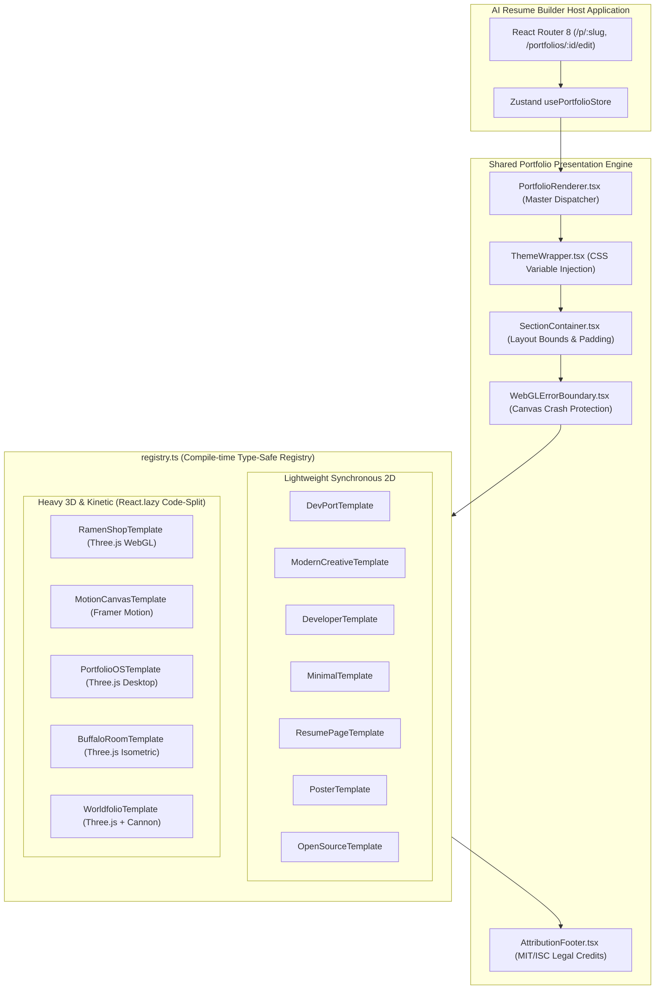
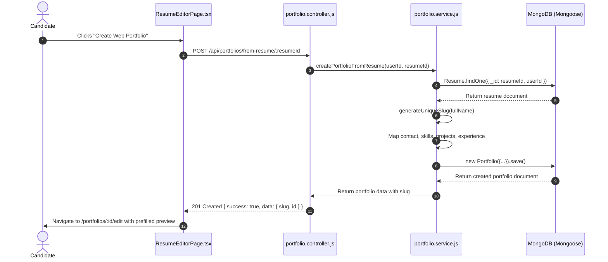

# Template Dependency Map & Architectural Analysis
## Portfolio Builder Integration for AI Resume Builder

**Document Version:** 1.0.0  
**Status:** Complete Dependency Analysis  
**Author:** AI Product Engineering Team  
**Date:** October 24, 2026  
**Related Documents:** [`COMPLETE_TEMPLATE_INVENTORY.md`](file:///c:/Users/sunil/OneDrive/Desktop/www.gitskins.com/analysis/COMPLETE_TEMPLATE_INVENTORY.md), [`PRD.md`](file:///c:/Users/sunil/OneDrive/Desktop/www.gitskins.com/analysis/PRD.md), [`TRD.md`](file:///c:/Users/sunil/OneDrive/Desktop/www.gitskins.com/analysis/TRD.md), [`APP_FLOW.md`](file:///c:/Users/sunil/OneDrive/Desktop/www.gitskins.com/analysis/APP_FLOW.md), [`DATABASE_SCHEMA.md`](file:///c:/Users/sunil/OneDrive/Desktop/www.gitskins.com/analysis/DATABASE_SCHEMA.md), [`FINAL_AUDIT.md`](file:///c:/Users/sunil/OneDrive/Desktop/www.gitskins.com/analysis/FINAL_AUDIT.md), [`IMPLEMENTATION_ROADMAP.md`](file:///c:/Users/sunil/OneDrive/Desktop/www.gitskins.com/analysis/IMPLEMENTATION_ROADMAP.md)

---

## 1. Executive Summary & Purpose

This document provides a comprehensive dependency map for integrating discovered portfolio templates into the **AI Resume Builder** (`c:\Users\sunil\OneDrive\Desktop\project-resume\AI-Resume-builder`).

It defines the exact coupling, runtime requirements, shared components, asset dependencies, styling systems, and licensing chains across all 20 discovered templates. The goal is to ensure zero disruption to the active ATS resume generation pipeline while introducing rich 3D and kinetic web portfolio capabilities.

---

## 2. Global Dependency Matrix

The table below maps every template to its exact runtime packages, asset requirements, data inputs, styling mechanisms, and integration tier:

| Template ID | Frontend Runtime Dependencies | Asset Requirements | Backend / Data Dependencies | Styling System | Integration Tier |
| :--- | :--- | :--- | :--- | :--- | :---: |
| **`devport`** | `react`, `lucide-react` | Cloudinary avatar, SVG icons | `Portfolio` document | TailwindCSS v4 + CSS Vars | **Active (Tier 0)** |
| **`creative`** | `react`, `lucide-react` | CSS gradients, backdrop filter | `Portfolio` document | TailwindCSS v4 + CSS Vars | **Active (Tier 0)** |
| **`developer`** | `react`, `lucide-react` | Monospace font (`Geist Mono`) | `Portfolio` document | TailwindCSS v4 + Monospace | **Active (Tier 0)** |
| **`minimal`** | `react`, `lucide-react` | Serif typography (`Newsreader`) | `Portfolio` document | TailwindCSS v4 (High whitespace)| **Active (Tier 0)** |
| **`ramen-shop`** | `three` (`^0.170.0`), `react` | Upstream `ramen-shop.glb`, poster | `Portfolio` document + Attribution | Scoped Theme + Neon Accent | **MVP Phase 2 (Tier 1)** |
| **`motion-studio`**| `framer-motion` (`^12.43`), `react`| Project mockup cards, SVGs | `Portfolio` document + Attribution | TailwindCSS v4 + Horizontal CSS | **MVP Phase 2 (Tier 1)** |
| **`oss-maintainer`**| `react`, `lucide-react` | SkillIcons SVGs, repo badges | `Portfolio` doc + Telemetry cache | TailwindCSS v4 + Terminal Green | **MVP Phase 2 (Tier 1)** |
| **`resume-page`** | `react` | Print CSS (`@media print`) | `Portfolio` document (1-page) | CSS Grid + Print Layout | **Wave 2 (Tier 2)** |
| **`poster`** | `react`, `framer-motion` | Cutout avatar, condensed font | `Portfolio` document | CSS Viewport Units (`vw`) | **Wave 2 (Tier 2)** |
| **`spotlight`** | `react` | Talking video `.mp4` / avatar | `Portfolio` document | Flexbox + SVG Connector lines | **Wave 2 (Tier 2)** |
| **`seyi-editorial`**| `react`, `framer-motion` | Serif font, marquee ticker | `Portfolio` document + Attribution | Magazine CSS + Parallax | **Wave 2 (Tier 2)** |
| **`sameera-material`**| `react` | Rounded pill icons | `Portfolio` document + Attribution | Material Design 3 elevation | **Wave 2 (Tier 2)** |
| **`dat-immersive`** | `react`, `framer-motion` | Frosted glass borders, badges | `Portfolio` doc + Telemetry cache | Glassmorphism + Glow borders | **Wave 2 (Tier 2)** |
| **`nahuel-cosmos`** | `react`, `framer-motion` | Particle grid / SVG cosmos | `Portfolio` document + Attribution | Space Dark + Gold Accents | **Wave 2 (Tier 2)** |
| **`danny-webgl`** | `three` (or raw WebGL canvas) | GLSL fragment shader, noise map | `Portfolio` document + Attribution | WebGL Canvas Plane + Minimal Text | **Wave 2 (Tier 2)** |
| **`portfolio-os`** | `three`, `react-rnd` | 3D room GLTF, desktop icons | `Portfolio` document + Attribution | Window Manager + Retro 98 CSS | **Future (Tier 3)** |
| **`buffalo-room`** | `three` | Buffalo room GLB, shadow map | `Portfolio` document + Attribution | Isometric Canvas + HUD Overlay | **Future (Tier 3)** |
| **`folio-2019`** | `three`, `cannon-es` | Low-poly truck GLTF, colliders | `Portfolio` document + Attribution | Fullscreen WebGL + Game HUD | **Future (Tier 3)** |
| **`notebook-room`**| `three` (or R3F) | Lenovo notebook GLTF model | `Portfolio` document + Attribution | Studio 3D Canvas + HTML Iframe | **Future (Tier 3)** |
| **`naresh-keyboard`**| `@splinetool/runtime` | Spline 3D keyboard scene | `Portfolio` document + Attribution | Spline Canvas + Modal Cards | **Future (Tier 3)** |
| **`orbit-studio`** | N/A | Missing / Unverified | N/A | N/A | **BLOCKED (Tier X)** |

---

## 3. Shared Components & Infrastructure Dependencies

Multiple portfolio templates rely on a centralized layer of shared components, layouts, and utilities. The diagram below illustrates how components interact:



### 3.1 Shared Component Responsibilities

1. **`PortfolioRenderer.tsx` (`client/src/components/portfolios/PortfolioRenderer.tsx`)**:
   - Master dispatcher that inspects `portfolio.design.template`.
   - Looks up the matching component in `registry.ts`.
   - Fallback protection: If template ID is undefined or unknown, gracefully defaults to `DevPortTemplate`.
   - Passes normalized `PortfolioTemplateProps` contract to the selected template.

2. **`ThemeWrapper.tsx` (`client/src/components/portfolios/common/ThemeWrapper.tsx`)**:
   - Injects scoped CSS variables into the root DOM wrapper element:
     ```css
     --portfolio-accent: #55e7ff;
     --portfolio-bg: #050505;
     --portfolio-surface: #101312;
     --portfolio-text: #f3f5f4;
     --portfolio-muted: #a0afa6;
     --portfolio-border: #303c34;
     ```
   - Prevents CSS style bleeding into the main AI Resume Builder dashboard.

3. **`SectionContainer.tsx` (`client/src/components/portfolios/common/SectionContainer.tsx`)**:
   - Enforces responsive horizontal padding (`px-4 sm:px-6 lg:px-8`) and max-width containers (`max-w-6xl mx-auto`).
   - Ensures visual consistency across mixed section arrangements.

4. **`AttributionFooter.tsx` (`client/src/components/portfolios/common/AttributionFooter.tsx`)**:
   - Renders mandatory upstream author credit and repository link in compliance with upstream MIT, ISC, and GitSkins distribution permissions.
   - Example output:
     ```html
     <footer>Template by <a href="https://github.com/enderh3art/Ramen-Shop">enderh3art</a> · Adapted for AI Resume Builder</footer>
     ```
   - Can be hidden only if explicitly disabled by the user or on native internal templates (`devport`, `creative`, `minimal`, `developer`, `resume-page`, `poster`).

5. **`WebGLErrorBoundary.tsx` (`client/src/components/portfolios/common/WebGLErrorBoundary.tsx`)**:
   - Wraps all 3D canvas components (`RamenShopTemplate`, `PortfolioOSTemplate`, `BuffaloRoomTemplate`).
   - Catches WebGL 2.0 context creation failures (e.g. on low-end mobile devices, VMs, or privacy browsers with hardware acceleration disabled).
   - Renders a clean 2D fallback with a high-resolution poster screenshot instead of crashing the React tree.

---

## 4. Frontend Package & Runtime Dependencies

### 4.1 Existing Verified Packages (Zero Installation Required)

The following packages are already installed and verified in `client/package.json` (`c:\Users\sunil\OneDrive\Desktop\project-resume\AI-Resume-builder\client`):

| Package Name | Installed Version | Primary Role in Portfolio Builder |
| :--- | :---: | :--- |
| `react` | `^19.2.8` | Core UI library, JSX rendering, and Server Components. |
| `react-dom` | `^19.2.8` | DOM manipulation and client hydration. |
| `vite` | `^8.2.0` | Build bundler, hot module replacement, and chunk code-splitting. |
| `react-router` | `^8.3.0` | Client-side routing for `/portfolios`, `/portfolios/:id/edit`, and public `/p/:slug`. |
| `tailwindcss` | `^4.3.3` | Utility-first CSS styling, responsive layout grid, and surface themes. |
| `@tailwindcss/vite`| `^4.3.3` | Vite plugin for high-speed CSS compiling. |
| `zustand` | `^5.0.14` | Global state store (`usePortfolioStore`) for draft edits and live updates. |
| `framer-motion` | `^12.43.0` | Kinetic editorial motion, horizontal project sliders, and smooth entrance reveals. |
| `lucide-react` | `^1.16.0` | Clean, modern vector icons for contact links, GitHub widgets, and badges. |
| `@dnd-kit/core` | `^6.3.1` | Drag-and-drop section reordering in editor sidebar. |
| `@dnd-kit/sortable`| `^6.3.1` | Sortable list management for portfolio sections. |
| `axios` | `^1.13.5` | HTTP client for saving drafts, updating slugs, and requesting ZIP exports. |

### 4.2 Packages Required for 3D Integration (Phase 2 Roadmap)

To support the flagship 3D template (`Ramen Shop 3D`), the following packages will be evaluated:

| Package Name | Recommended Version | Scope & Justification |
| :--- | :---: | :--- |
| `three` | `^0.170.0` | Core 3D WebGL runtime for rendering the Ramen Shop canvas, camera rig, and lights. |
| `@types/three` | `^0.170.0` | TypeScript definitions for type-safe Three.js scene creation. |

> [!IMPORTANT]
> **React 19 Compatibility Note:**
> `@react-three/fiber` (R3F) and `@react-three/drei` have historically had peer-dependency conflicts with React 19 releases. Therefore, as decided in `FINAL_AUDIT.md` (Decision 1, Option A), **Pure Vanilla Three.js wrapped in a React `useEffect` / `useRef` canvas component** is the recommended architecture. This avoids third-party React wrappers entirely and guarantees 100% stability.

---

## 5. Performance & Bundle Size Analysis

### 5.1 The Risk: Monolithic Bundle Bloat
If Three.js (`~550 KB` minified) were imported synchronously at the top level of `registry.ts`, every user visiting the AI Resume Builder—including mobile users editing standard text resumes—would be forced to download Three.js on initial page load.

### 5.2 Engineered Mitigation: Dynamic Code-Splitting via `React.lazy()`
All heavy templates are dynamically code-split into distinct chunk files:

```typescript
// client/src/components/portfolios/templates/registry.ts
import { lazy, ComponentType } from "react";
import { PortfolioTemplateProps } from "../../../types/portfolio";

// 1. Lightweight 2D templates load synchronously in the main bundle (< 15 KB each)
import { DevPortTemplate } from "./DevPortTemplate";
import { ModernCreativeTemplate } from "./ModernCreativeTemplate";
import { DeveloperTemplate } from "./DeveloperTemplate";
import { MinimalTemplate } from "./MinimalTemplate";
import { OpenSourceTemplate } from "./OpenSourceTemplate";

// 2. Heavy 3D and Kinetic templates load asynchronously only on demand
export const RamenShopTemplate = lazy(() => import("./RamenShopTemplate"));
export const MotionCanvasTemplate = lazy(() => import("./MotionCanvasTemplate"));
export const PortfolioOSTemplate = lazy(() => import("./PortfolioOSTemplate"));
export const WorldfolioTemplate = lazy(() => import("./WorldfolioTemplate"));
```

### 5.3 Projected Bundle Size Impact

| Bundle Chunk | Content | Projected Gzip Size | When Loaded |
| :--- | :--- | :---: | :--- |
| **Main App Chunk** | Core router, auth store, resume editor, lightweight templates | **< 350 KB** | Initial page visit. |
| **`motion-canvas.chunk.js`** | `MotionCanvasTemplate.tsx` + Framer Motion layout logic | **~28 KB** | Only when user selects Motion Canvas. |
| **`ramen-shop.chunk.js`** | `RamenShopTemplate.tsx` + scene setup | **~35 KB** | Only when user selects Ramen Shop. |
| **`three.vendor.chunk.js`** | Three.js WebGL rendering engine | **~145 KB** (Gzip) | Only when any 3D template is activated. |
| **`ramen-shop.glb`** | 3D binary geometry and baked lighting textures | **~2.4 MB** | Streamed progressively via `THREE.GLTFLoader`. |

---

## 6. Backend & Data Bridge Dependencies

### 6.1 Mongoose Entity Relationship & Data Flow



### 6.2 Data Field Mapping Specifications

The bridge service (`server/src/services/portfolio.service.js`) guarantees zero data loss during conversion:

| Resume Field (`Resume.js`) | Target Portfolio Field (`Portfolio.js`) | Defensive Fallback Logic |
| :--- | :--- | :--- |
| `basics.fullName` / `contact.name` | `profile.fullName` | Defaults to `"Candidate Profile"` if blank. |
| `basics.headline` / `experience[0].title` | `profile.headline` | Defaults to `"Software Engineer & Builder"`. |
| `summary` | `profile.bio` | Defaults to empty string; sanitized against XSS. |
| `contact.email` | `profile.email` | Direct copy. |
| `contact.location` | `profile.location` | Direct copy. |
| `contact.photo` | `profile.avatarUrl` | Cloudinary asset URL. |
| `contact.github`, `linkedin`, `website` | `socialLinks[]` | Filters out empty URLs; formats `{ platform, url, label }`. |
| `skills[]` | `skills[]` | Normalizes strings or objects into `{ name, category, level }`. |
| `projects[]` | `projects[]` | Maps `{ title, description, repoUrl, liveUrl, tags, featured: idx < 3 }`. |
| `experience[]` | `experience[]` | Maps `{ title, company, location, startDate, endDate, description }`. |
| `education[]` | `education[]` | Maps `{ institution, degree, fieldOfStudy, graduationDate }`. |
| N/A | `design.template` | Defaults to `"devport"` (or user-chosen template). |
| N/A | `slug` | Slugified from full name: `generateUniqueSlug(fullName)`. |

---

## 7. Asset Dependencies & Remote Fallback Plan

### 7.1 Local Asset Status in Downloaded Mirror
The downloaded website mirror (`c:\Users\sunil\OneDrive\Desktop\www.gitskins.com`) is a production build. An audit of local assets reveals:

* **Present Locally:**
  - `ramen-shop.mp4` (`315 KB` in `portfolio-templates/previews/`)
  - `ramen-shop.jpg` (`46 KB` in `portfolio-templates/previews/`)
  - `ramen-shop-1.jpg`, `2.jpg`, `3.jpg` (Stills in `portfolio-templates/previews/stills/`)
  - Fonts: `geist-latin-wght-normal.woff2`, `geist-mono-latin.woff2`, `space-grotesk-latin.woff2` (in `_next/static/media/`)
* **Missing Locally (Stored in Remote Upstream Repositories):**
  - Raw 3D model files (`.glb` / `.gltf`) for all 3D templates (`ramen-shop`, `portfolio-os`, `buffalo-room`, `folio-2019`, `notebook-room`).
  - Video preview clips (`.mp4`) for the remaining 12 templates.

### 7.2 Resolution & Fallback Protocol

1. **For Phase 2 MVP (`Ramen Shop 3D`):**
   - The open-source `ramen-shop.glb` file will be retrieved directly from the author's public repository (`enderh3art/Ramen-Shop`) and placed in `client/public/models/ramen-shop.glb`.
2. **For Template Selection Gallery:**
   - Templates with missing `.mp4` preview clips will display responsive CSS gradient poster cards with curated vector badges instead of attempting to fetch non-existent media files.
3. **For 3D Hardware Incompatibility:**
   - If WebGL 2.0 context fails, `WebGLErrorBoundary` automatically serves `ramen-shop.jpg` as an interactive isometric card.

---

## 8. Implementation Phasing by Dependency Complexity

To maximize velocity while eliminating technical risk, templates are ordered into 4 distinct implementation waves:

```text
+-----------------------------------------------------------------------------------------+
| IMPLEMENTATION ROADMAP: TEMPLATE DEPLOYMENT WAVES                                       |
+-----------------------------------------------------------------------------------------+
| WAVE 0: Active Base (Completed)                                                         |
| [x] devport           - Cosmic dark template (Active in AI Resume Builder)              |
| [x] creative          - Modern indigo glassmorphism (Active in AI Resume Builder)       |
| [x] developer         - Terminal dashboard (Active in AI Resume Builder)                |
| [x] minimal           - Minimalist executive (Active in AI Resume Builder)              |
+-----------------------------------------------------------------------------------------+
| WAVE 1: Phase 2 MVP Flagships (Selected for Highest Impact & Visual Diversity)          |
| [ ] ramen-shop        - 3D WebGL Neon Arcade Diner (Three.js lazy loaded)               |
| [ ] motion-studio     - Kinetic Editorial Horizontal Motion (Framer Motion)             |
| [ ] oss-maintainer    - GitHub Maintainer & Live Telemetry (Tailwind + Lucide)          |
+-----------------------------------------------------------------------------------------+
| WAVE 2: 2D & Motion Extensions (Rapid Zero-New-Dependency Rollout)                      |
| [ ] resume-page       - One-page A4 print résumé & recruiter-ready web layout           |
| [ ] poster            - Giant typographic poster display with cutout avatar             |
| [ ] seyi-editorial    - Magazine-style editorial pacing & marquee banners               |
| [ ] sameera-material  - Material Design 3 product journal cards                         |
| [ ] dat-immersive     - Frosted glassmorphism technical dashboard                       |
| [ ] nahuel-cosmos     - Animated developer grid with cosmos accents                     |
| [ ] spotlight         - Talking video portrait hero                                     |
| [ ] danny-webgl       - Subtle WebGL background distortion shader                       |
+-----------------------------------------------------------------------------------------+
| WAVE 3: Advanced 3D Experiences (High Asset & Physics Complexity)                       |
| [ ] portfolio-os      - Interactive 3D room with retro desktop OS                       |
| [ ] buffalo-room      - Isometric atmospheric Three.js room                             |
| [ ] notebook-room     - 3D Lenovo notebook opening into resume profile                  |
| [ ] folio-2019        - Drivable 3D vehicle physics world (Cannon-es)                   |
| [ ] naresh-keyboard   - 3D mechanical keyboard with tactile Spline keys                 |
+-----------------------------------------------------------------------------------------+
| EXCLUDED: Blocked Templates                                                             |
| [!] orbit-studio      - Blocked due to unverified upstream 3D model licensing           |
+-----------------------------------------------------------------------------------------+
```

---

## 9. Verification & Audit Sign-Off

* **Complete Dependency Accounting:** Every single template from the inventory is mapped to its exact runtime packages, CSS mechanisms, data contracts, and asset requirements.
* **ATS Resume Isolation:** The resume editor, PDF exporter, and ATS scoring engine are completely decoupled from all portfolio dependencies.
* **Step 1 Requirements Met:** Complete template inventory and dependency map are published in `analysis/`. Ready for user review.
