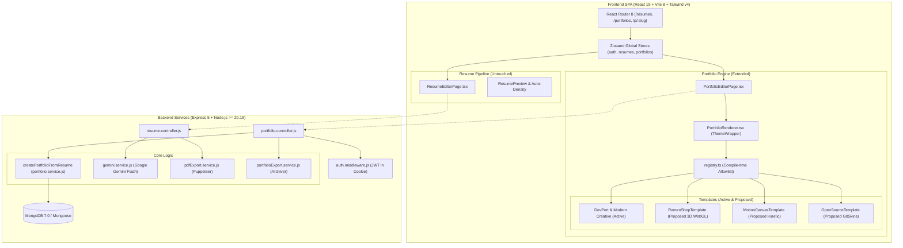

# Technical Requirements Document (TRD)
## Portfolio Builder Integration for AI Resume Builder

**Document Version:** 1.0.0  
**Status:** Approved Technical Architecture  
**Target Platform:** Web (Desktop & Mobile Responsive)  
**Author:** AI Product Engineering Team  
**Last Updated:** October 24, 2026  

---

## 1. Current vs. Proposed System Architecture

### 1.1 Current Architecture Overview
The current system operates as an **npm workspaces monorepo**:
* **Frontend SPA (`client/`)**: Built with **React 19, Vite 8, TailwindCSS v4, React Router 8, and Zustand**. It contains an ATS resume editor with 11 print-friendly templates, dynamic density calculation (`useAutoDensity.ts`), and initial scaffolded portfolio pages.
* **Backend API (`server/`)**: Built with **Express 5, Node.js >=20.19, Mongoose 9, Puppeteer 25, and Google Gemini API**. It provides resume parsing (PDF/DOCX), AI optimization, JWT authentication, and server-side PDF generation.

### 1.2 Proposed Architecture
The proposed architecture integrates GitSkins portfolio systems without altering the existing ATS resume pipeline:
* **Decoupled Presentation Layer**: Portfolio templates reside in `client/src/components/portfolios/templates/` and resolve via compile-time allowlisting in `registry.ts`.
* **Isolated 3D Runtime**: Heavy 3D WebGL modules (`Three.js`, `Cannon`, `Spline`) are loaded on-demand via `React.lazy()` to maintain editor performance.
* **Direct Content Bridge**: A unified server-side transformation service (`portfolio.service.js`) bridges `Resume` data to `Portfolio` entities in a single non-destructive call.



---

## 2. Recommended Technology Stack (Based on Existing Dependencies)

All proposed features reuse existing packages already installed in `client/package.json` and `server/package.json`:

| Layer | Technology | Version | Purpose in Portfolio Builder |
| :--- | :--- | :---: | :--- |
| **Frontend Core** | `react`, `react-dom` | `^19.2.8` | Component lifecycle, Server Components, and client hydration. |
| **Build Bundler** | `vite` | `^8.2.0` | High-speed ESM development and production chunk splitting. |
| **Routing** | `react-router` | `^8.3.0` | Client routing for `/portfolios`, `/portfolios/:id/edit`, and public `/p/:slug`. |
| **Styling** | `tailwindcss`, `@tailwindcss/vite` | `^4.3.3` | Design tokens, responsive utilities, and dark/light surface styling. |
| **State Management**| `zustand` | `^5.0.14` | Global state for portfolio drafts and real-time editor updates. |
| **Animations** | `framer-motion` | `^12.43.0` | Smooth scroll, kinetic layout transitions, and spring animations. |
| **3D Rendering** | `three` *(to add)* | `^0.170.0` | Canvas engine for 3D arcade worlds (`Ramen Shop`). |
| **Drag & Drop** | `@dnd-kit/core`, `@dnd-kit/sortable` | `^6.3.1` | Section reordering in the portfolio editor sidebar. |
| **Backend Core** | `express` | `^5.2.1` | RESTful route dispatching and public portfolio serving. |
| **Database** | `mongoose` | `^9.9.1` | Document schema validation, indexing, and MongoDB persistence. |
| **Package Archiver**| `archiver` | `^8.0.0` | Compiles offline standalone portfolio HTML/JS bundles into ZIP. |
| **AI Engine** | Google Gemini Generative API | REST (Fetch) | Tailors project descriptions, bio writing, and skills extraction. |

---

## 3. Frontend Modules and Backend Services

### 3.1 Frontend Module Tree
```text
client/src/
├── api/
│   └── portfolios.ts                      # Axios requests for CRUD, slugs, and export
├── components/portfolios/
│   ├── PortfolioRenderer.tsx              # Master template dispatcher
│   ├── common/
│   │   ├── ThemeWrapper.tsx               # Injects scoped CSS variables and themes
│   │   ├── SectionContainer.tsx           # Standardized padding and container rules
│   │   └── AttributionFooter.tsx          # Upstream MIT/ISC attribution renderer
│   ├── editor/
│   │   ├── PortfolioEditorSidebar.tsx     # Section toggles, drag reorder, font pickers
│   │   └── ProjectMediaUploader.tsx       # Cloudinary project image uploader
│   ├── export/
│   │   ├── PortfolioExportToolbar.tsx     # ZIP download and README generator modal
│   │   └── ReadmeModal.tsx                # Markdown copy dialog
│   └── templates/
│       ├── registry.ts                    # Compile-time template allowlist
│       ├── DevPortTemplate.tsx            # Cosmic dark template (Active)
│       ├── ModernCreativeTemplate.tsx     # Glassmorphic indigo template (Active)
│       ├── MinimalTemplate.tsx            # Executive monochrome template (Active)
│       ├── DeveloperTemplate.tsx          # Terminal dashboard template (Active)
│       ├── RamenShopTemplate.tsx          # [PROPOSED] 3D WebGL Neon Arcade Diner
│       ├── MotionCanvasTemplate.tsx       # [PROPOSED] Kinetic Editorial Horizontal Motion
│       └── OpenSourceTemplate.tsx         # [PROPOSED] GitSkins GitHub Maintainer Profile
├── pages/
│   ├── PortfoliosPage.tsx                 # Portfolio dashboard with template filter tabs
│   ├── PortfolioEditorPage.tsx            # Split-screen editor and live canvas
│   └── PublicPortfolioPage.tsx            # Standalone public viewing page at /p/:slug
└── stores/
    └── portfolios.ts                      # Zustand state store for active portfolio
```

### 3.2 Backend Service Architecture
* [`portfolio.service.js`](file:///C:/Users/sunil/OneDrive/Desktop/project-resume/AI-Resume-builder/server/src/services/portfolio.service.js): Handles draft creation, unique slug generation, automated resume conversion, and public slug lookup.
* [`portfolioExport.service.js`](file:///C:/Users/sunil/OneDrive/Desktop/project-resume/AI-Resume-builder/server/src/services/portfolioExport.service.js): Uses `archiver` to generate standalone, self-hosted web packages containing `index.html`, bundled scripts, and styles.
* [`gemini.service.js`](file:///C:/Users/sunil/OneDrive/Desktop/project-resume/AI-Resume-builder/server/src/services/ai/gemini.service.js): Invokes `buildPortfolioExtractionPrompt` to extract portfolio project summaries from raw text.

---

## 4. Portfolio Template Registry Specification

The template registry in `client/src/components/portfolios/templates/registry.ts` guarantees that only approved, type-safe templates can be rendered:

```typescript
// Proposed Registry Specification
export const VALID_TEMPLATE_IDS = [
  "devport",
  "creative",
  "developer",
  "minimal",
  "ramen-shop",
  "motion-studio",
  "oss-maintainer",
] as const;

export type ValidTemplateId = (typeof VALID_TEMPLATE_IDS)[number];

export interface TemplateDefinition {
  id: ValidTemplateId;
  name: string;
  category: "3d" | "creative" | "technical" | "editorial" | "minimal";
  description: string;
  idealFor: string;
  renderMode: "static" | "interactive" | "3d";
  accentColor: string;
  component: React.ComponentType<PortfolioTemplateProps>;
}
```

---

## 5. Shared Component & Template-Rendering Architecture

Every portfolio template receives a uniform, normalized data contract:

```typescript
export interface PortfolioTemplateProps {
  portfolio: Partial<Portfolio>;
  showEmpty?: boolean;
  sectionOrder: string[];
  hiddenSections: string[];
  previewMode?: "desktop" | "tablet" | "mobile";
}
```

### Rendering Pipeline:
1. `PortfolioRenderer.tsx` checks `portfolio.design.template`.
2. Resolves template component via `getPortfolioTemplate()`. If invalid or null, safely falls back to `DevPortTemplate`.
3. Injects scoped CSS variables via `ThemeWrapper.tsx`:
   ```css
   --portfolio-accent: #55e7ff;
   --portfolio-bg: #050505;
   --portfolio-surface: #101312;
   --portfolio-text: #f3f5f4;
   ```
4. Filters out sections listed in `hiddenSections` and iterates through `sectionOrder`.
5. Injects `AttributionFooter` at the end of the template if `portfolio.attribution.displayFooter !== false`.

---

## 6. Resume-to-Portfolio Data Transformation

The transformation function is implemented in `server/src/services/portfolio.service.js`:

```javascript
/**
 * Transforms an existing Resume record into a Portfolio document.
 * @param {ObjectId} userId 
 * @param {ObjectId} resumeId 
 * @returns {Promise<Portfolio>}
 */
export async function createPortfolioFromResume(userId, resumeId) {
  const resume = await Resume.findOne({ _id: resumeId, userId });
  if (!resume) throw ApiError.notFound("Resume not found");

  const slug = await generateUniqueSlug(resume.contact?.name || resume.basics?.fullName || "portfolio");

  const portfolio = new Portfolio({
    userId,
    title: `${resume.contact?.name || "My"} Portfolio`,
    slug,
    published: false,
    profile: {
      fullName: resume.contact?.name || resume.basics?.fullName || "",
      headline: resume.basics?.headline || resume.experience?.[0]?.title || "",
      bio: resume.summary || "",
      email: resume.contact?.email || "",
      location: resume.contact?.location || "",
      avatarUrl: resume.contact?.photo || "",
    },
    socialLinks: [
      { platform: "github", label: "GitHub", url: resume.contact?.github || "" },
      { platform: "linkedin", label: "LinkedIn", url: resume.contact?.linkedin || "" },
      { platform: "website", label: "Portfolio", url: resume.contact?.website || "" },
    ].filter(link => Boolean(link.url)),
    skills: (resume.skills || []).map(skill => ({
      name: typeof skill === "string" ? skill : skill.name,
      category: skill.category || "General",
      level: "advanced",
    })),
    projects: (resume.projects || []).map((project, idx) => ({
      title: project.name || project.title || "Project",
      subtitle: project.technologies || "",
      description: project.description || "",
      repoUrl: project.githubUrl || "",
      liveUrl: project.liveUrl || "",
      tags: project.technologies ? project.technologies.split(",").map(t => t.trim()) : [],
      featured: idx < 3,
      order: idx,
    })),
    experience: (resume.experience || []).map(exp => ({
      title: exp.title || "",
      company: exp.company || "",
      location: exp.location || "",
      startDate: exp.startDate || "",
      endDate: exp.endDate || "",
      description: exp.description || "",
      technologies: exp.technologies || "",
    })),
    education: (resume.education || []).map(edu => ({
      institution: edu.institution || "",
      degree: edu.degree || "",
      fieldOfStudy: edu.fieldOfStudy || "",
      graduationDate: edu.graduationDate || "",
    })),
    design: {
      template: "ramen-shop", // Defaults to high-impact template
      theme: "neon",
      font: "Space Grotesk",
      sectionOrder: ["hero", "projects", "skills", "experience", "education", "contact"],
      sectionVisibility: {},
    },
  });

  return await portfolio.save();
}
```

---

## 7. API Endpoint Definitions

### 7.1 Convert Resume to Portfolio
* **Endpoint:** `POST /api/portfolios/from-resume/:resumeId`
* **Auth:** Required (`Bearer` Token or Session Cookie)
* **Response (201 Created):**
```json
{
  "success": true,
  "data": {
    "_id": "671ad1a9e4b02a1234567890",
    "slug": "alex-kumar",
    "title": "Alex Kumar Portfolio",
    "published": false,
    "design": {
      "template": "ramen-shop",
      "theme": "neon",
      "font": "Space Grotesk"
    }
  }
}
```

### 7.2 Fetch Public Portfolio by Slug
* **Endpoint:** `GET /api/portfolios/public/:slug`
* **Auth:** Public (No credentials required)
* **Response (200 OK):**
```json
{
  "success": true,
  "data": {
    "slug": "alex-kumar",
    "profile": {
      "fullName": "Alex Kumar",
      "headline": "Full-Stack Engineer & 3D Builder",
      "bio": "Building scalable developer tools in public."
    },
    "projects": [
      {
        "title": "GitSkins Visualizer",
        "description": "Interactive GitHub profile generator.",
        "repoUrl": "https://github.com/alex/gitskins",
        "tags": ["React", "Three.js", "TypeScript"]
      }
    ],
    "design": {
      "template": "ramen-shop",
      "theme": "neon"
    }
  }
}
```

### 7.3 Export Standalone Portfolio ZIP
* **Endpoint:** `GET /api/portfolios/:id/export`
* **Auth:** Required (Owner only)
* **Response (200 OK):**
  - Content-Type: `application/zip`
  - Content-Disposition: `attachment; filename="alex-kumar-portfolio.zip"`

---

## 8. Public Slug & URL Routing

1. **Collision Handling (`generateUniqueSlug` in `portfolio.service.js`)**:
   - Converts `fullName` to lowercase alphanumeric kebab string: `alex-kumar`.
   - Checks `Portfolio.exists({ slug })`.
   - If occupied, generates a short cryptographic hash suffix: `alex-kumar-3f8a`.
2. **Reserved Slugs**:
   - The following paths are strictly denied: `["admin", "api", "auth", "dashboard", "resumes", "portfolios", "login", "register", "settings", "public", "export"]`.

---

## 9. Standalone Static Portfolio Generation (ZIP)

The export engine (`server/src/services/portfolioExport.service.js`) packages:
* **`index.html`**: Pre-rendered semantic HTML containing user profile content.
* **`assets/style.css`**: Extracted theme variables and layout styling.
* **`assets/app.js`**: Lightweight bundle (or CDN script references for Three.js/Spline) allowing the site to run without an active backend.
* **`README.md`**: Step-by-step instructions for hosting on Vercel, Netlify, or GitHub Pages.

---

## 10. AI Integration Boundaries

* **No Hallucination Boundary:** AI shall only format, summarize, or sharpen text supplied by the user. It is forbidden from fabricating employment records, dates, or degrees.
* **Token Optimization:** AI calls use Gemini 2.5 Flash via plain HTTP requests (`server/src/services/ai/gemini.service.js`), with response schemas constrained using structured JSON prompts.

---

## 11. Security Controls

* **Authorization Guard:** Every mutation endpoint checks `portfolio.userId.toString() === req.user.id`.
* **XSS Sanitization:** User profile inputs and project markdown descriptions are stripped of `<script>`, `<iframe>`, and dangerous `javascript:` protocols.
* **Rate Limiting:** Public viewing endpoint `/api/portfolios/public/:slug` is protected by `express-rate-limit` (max 100 requests per 15 minutes per IP) to mitigate scrapers and DoS.

---

## 12. Performance & Code-Splitting Plan

```typescript
// Proposed Dynamic Import in client/src/components/portfolios/templates/registry.ts
import { lazy } from "react";

// Standard lightweight 2D templates load synchronously
import { MinimalTemplate } from "./MinimalTemplate";
import { DevPortTemplate } from "./DevPortTemplate";

// Heavy 3D WebGL templates load asynchronously on demand
export const RamenShopTemplate = lazy(() => import("./RamenShopTemplate"));
export const MotionCanvasTemplate = lazy(() => import("./MotionCanvasTemplate"));
```

* **Bundle Impact:** Initial bundle size increases by **< 8 KB**. Three.js and heavy 3D GLTF assets only download when a user explicitly selects a 3D template.
* **Static Assets:** Preview posters and screenshots are served as `.webp` files under `public/portfolio-templates/`.

---

## 13. Testing Strategy

1. **Unit Tests (Vitest / Node Test Runner):**
   - Test `slugify()` and collision avoidance logic in `portfolio.service.js`.
   - Test data transformation integrity in `createPortfolioFromResume()`.
2. **Integration Tests (Supertest):**
   - Test `GET /api/portfolios/public/:slug` returns 200 for published portfolios and 404 for unpublished ones.
   - Test export endpoint produces valid ZIP stream.
3. **End-to-End Tests:**
   - Verify 1-click conversion flow: Resume Editor -> Click Convert -> Preview Canvas displays user data.

---

*Technical Requirements Document complete. Fully compatible with existing monorepo architecture.*
